### Daftar Gambar
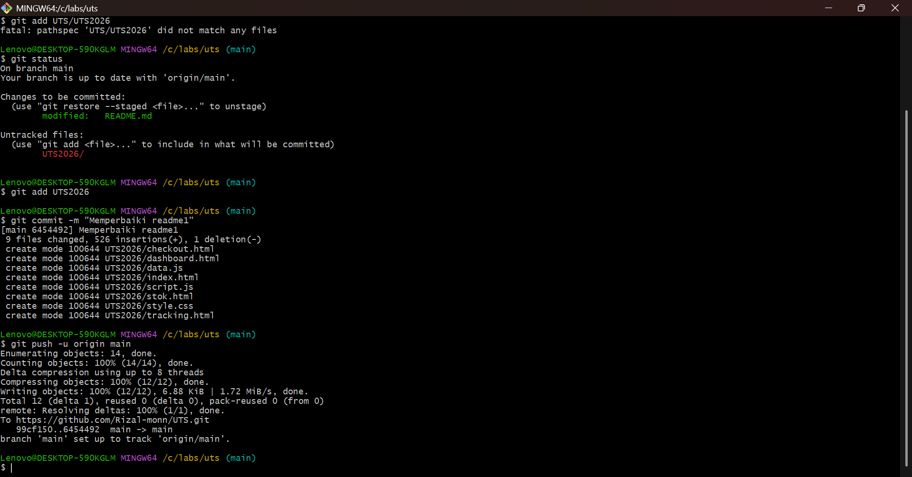
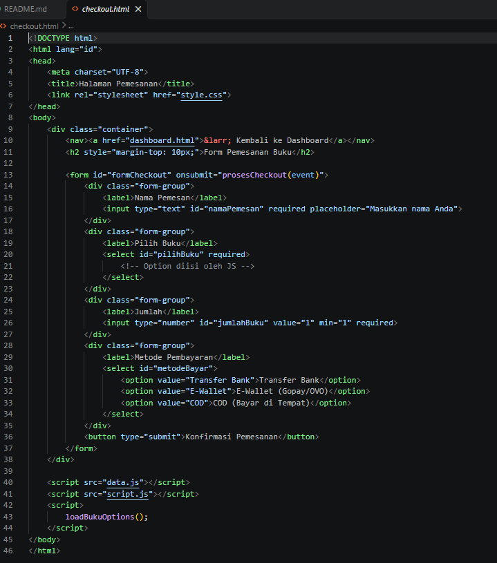
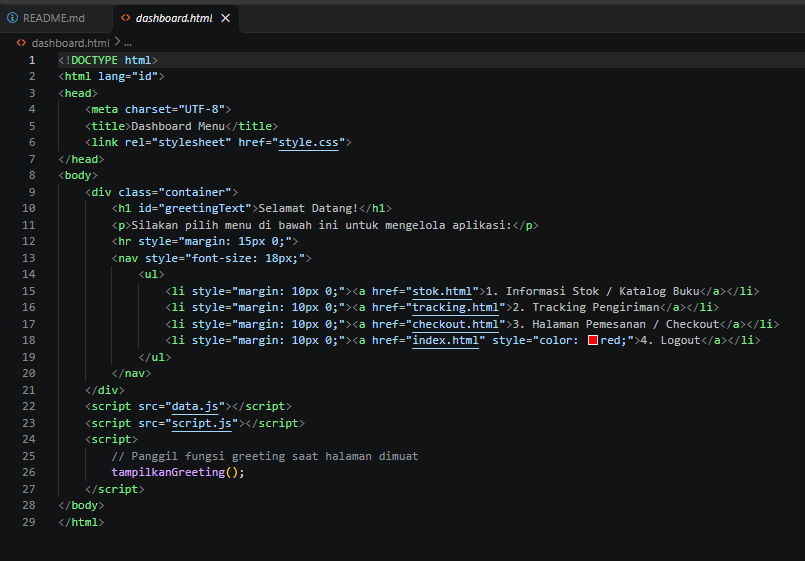
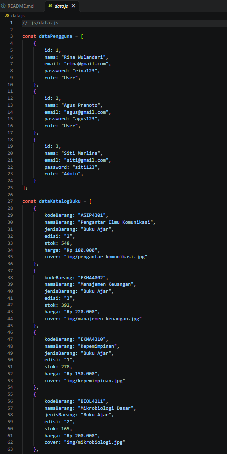
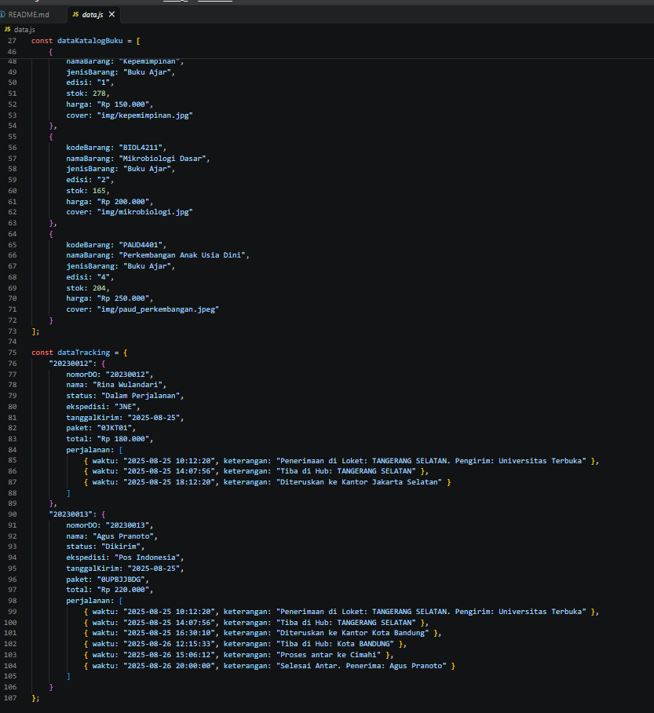
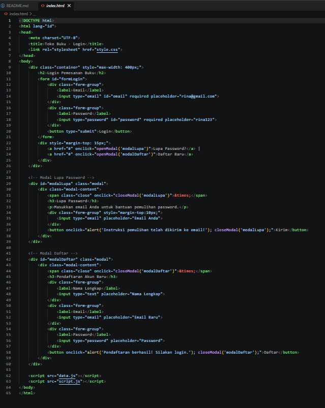
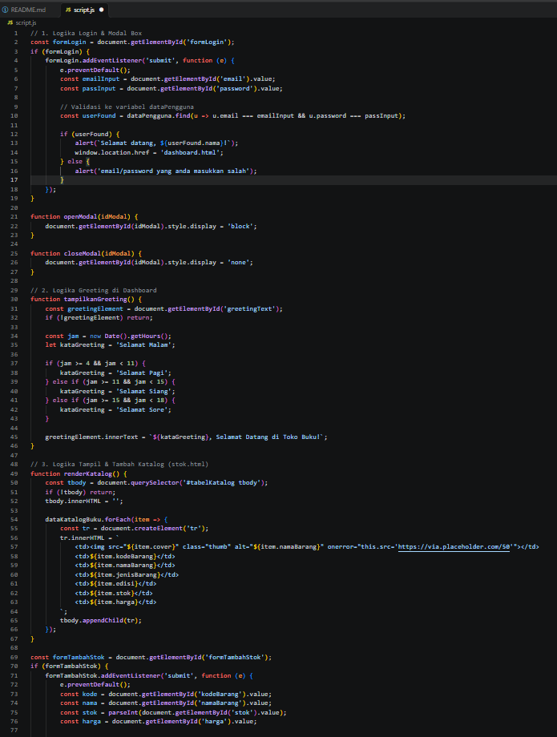
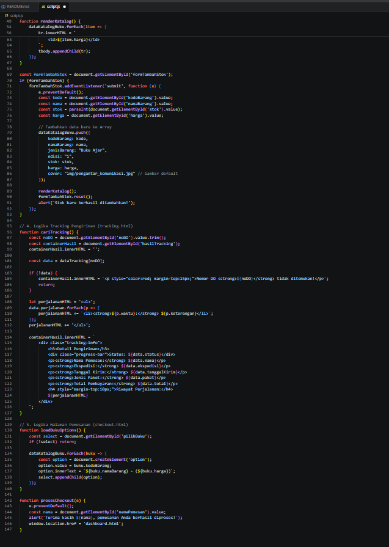
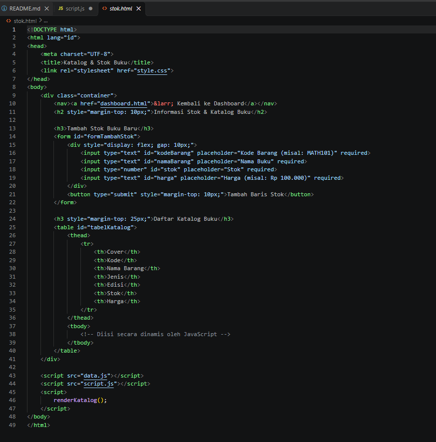
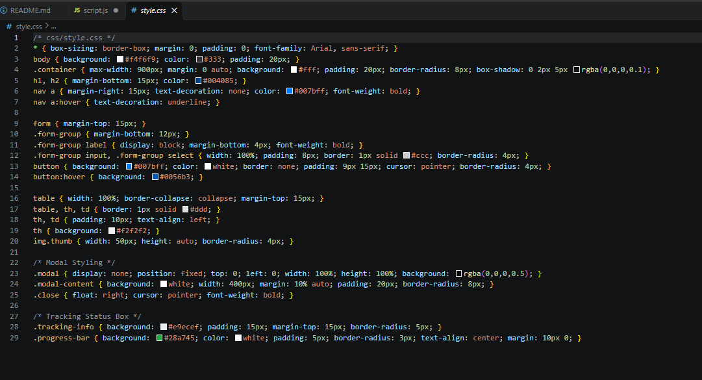
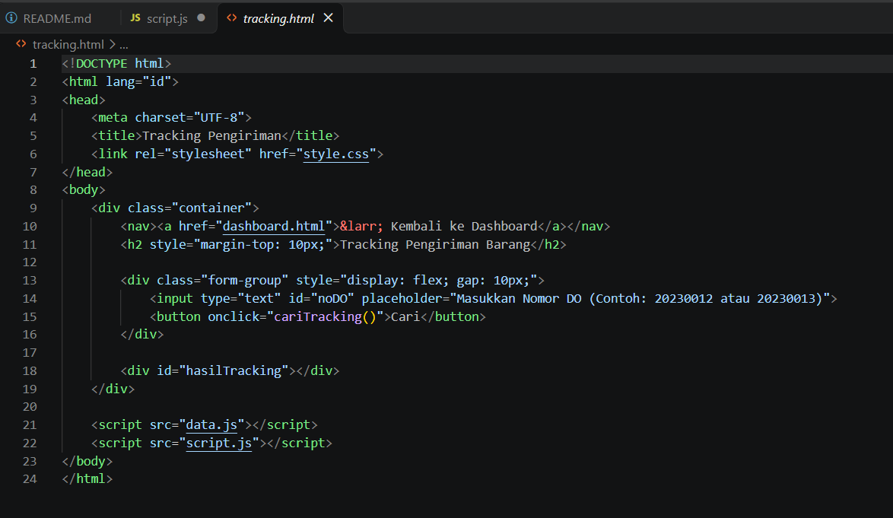
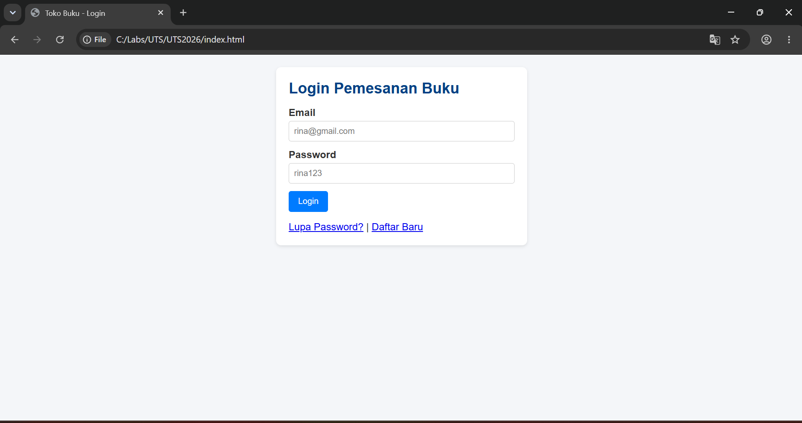
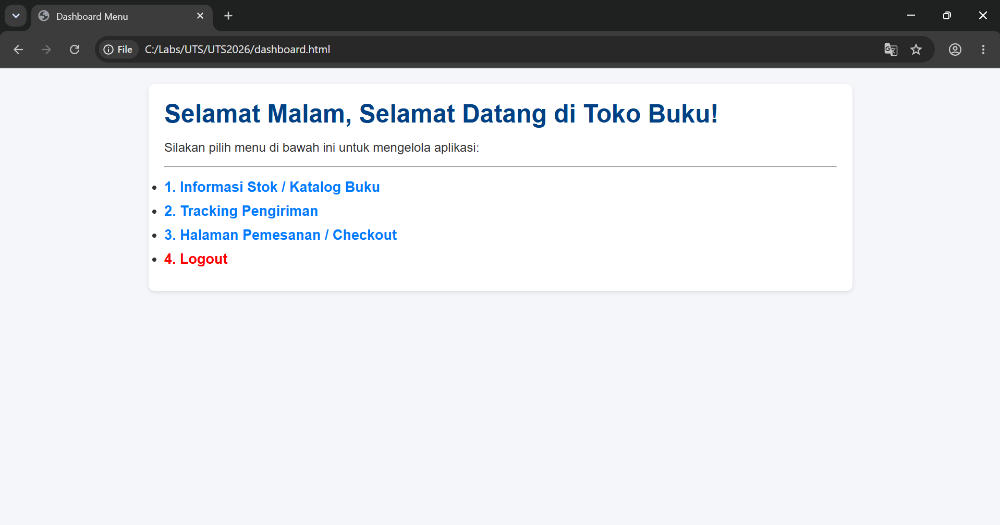
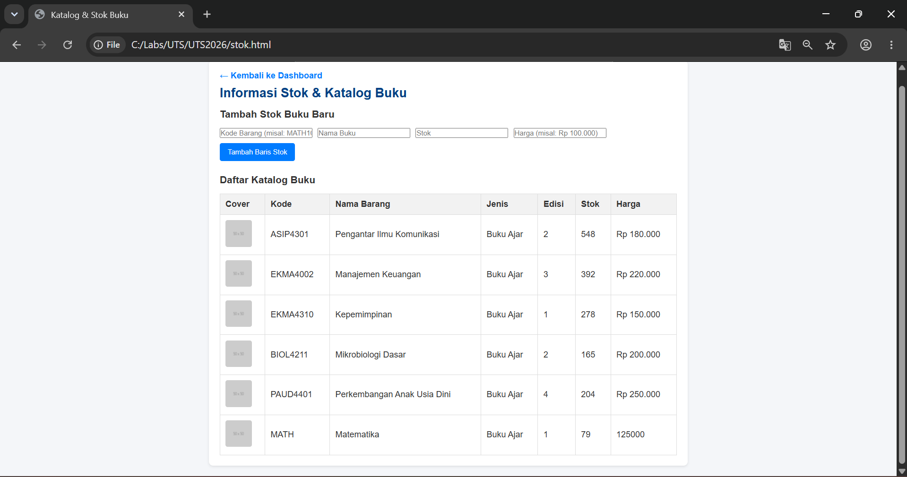
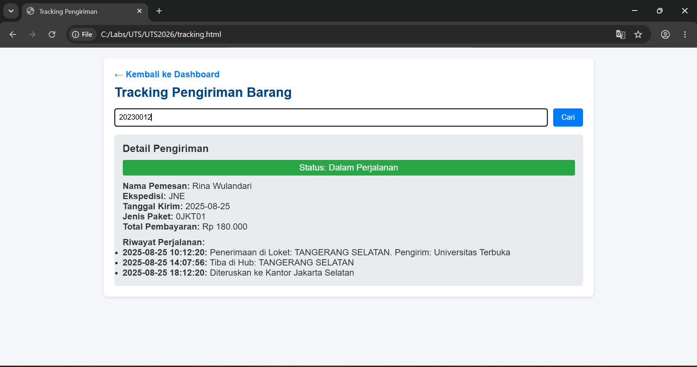
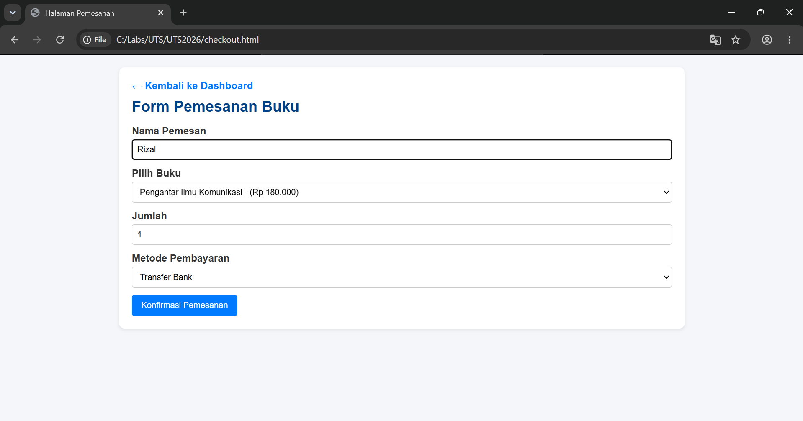
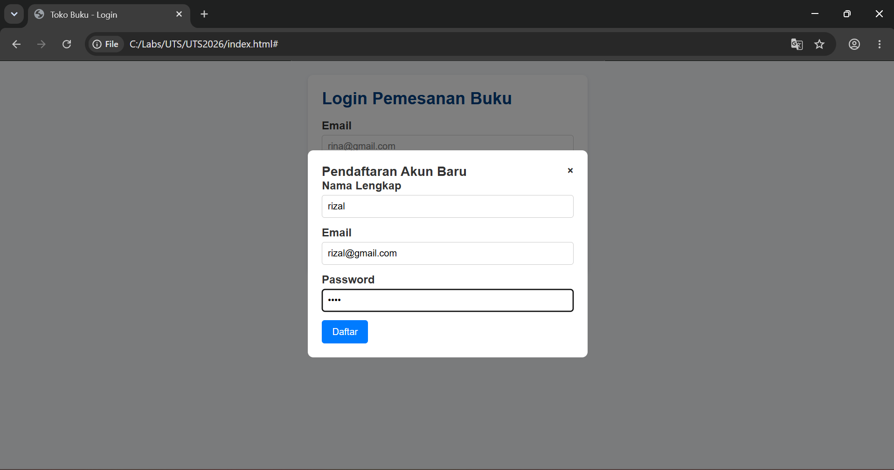

# Tugas UTS Pemrograman Web 1 - Aplikasi Toko Buku Online

Aplikasi web sederhana untuk pemesanan toko buku online berbasis Front-End modern yang dibangun menggunakan HTML5 semantik, CSS3, dan JavaScript (ES6 DOM Manipulation). Aplikasi ini menggunakan data dummy berbasis JSON Array/Object tanpa backend database.

---
## 📁 Struktur Folder Project

```text
tugas-uts-web1/
├── index.html        # Halaman Utama / Form Login
├── dashboard.html    # Halaman Dashboard Navigasi Utama
├── stok.html         # Halaman Informasi Stok & Katalog Buku
├── tracking.html     # Halaman Informasi Tracking Pengiriman (Nomor DO)
├── checkout.html     # Halaman Form Pemesanan & Pembayaran Buku
├── README.md         # Dokumentasi Project
├── css/
│   └── style.css     # File Styling Utama CSS
├── js/
│   ├── data.js       # File Data Dummy (Pengguna, Katalog, Tracking)
│   └── script.js     # File Logika Utama JavaScript & Manipulasi DOM
└── img/              # Asset Cover Buku & Aset Gambar
    ├── kepemimpinan.jpg
    ├── manajemen_keuangan.jpg
    ├── mikrobiologi.jpg
    ├── paud_perkembangan.jpeg
    └── pengantar_komunikasi.jpg

